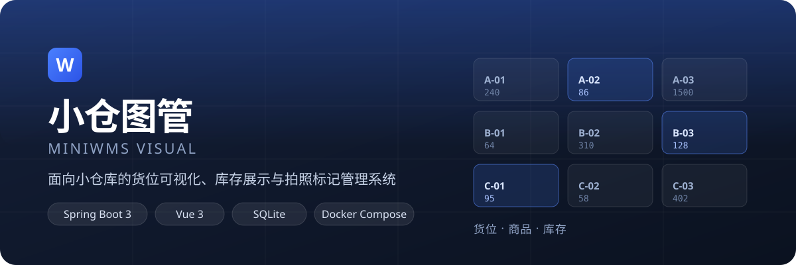

<p align="center">
  
</p>

**小仓图管 MiniWMS Visual** 把「仓库 → 库区 → 货架 → 储位」的物理结构搬进浏览器：货位状态、库存数量与进出流水在同一处看清，商品图片可拍照上传并打点标记。

| 层 | 技术 |
|---|---|
| 后端 | Spring Boot 3 · Java 17 · MyBatis-Plus · SQLite |
| 前端 | Vue 3 · Element Plus · Vite · Pinia · Vue Router |
| 部署 | Docker Compose 一键构建运行（国内 / 国外源可切换） |

## 功能

- **仓储储位维护** —— 仓库 / 库区 / 货架 / 储位逐级管理，储位可生成二维码
- **商品管理** —— 商品档案、类别、图片上传与图片打点标记
- **供应商管理** —— 供应商档案与资质图片
- **库存展示** —— 商品视图 / 储位视图 / 库存流水
- **入库 / 出库** —— 单据流转（新建 → 审核），出库支持拆分储位推荐
- **库存调整** —— 仅主程序电脑可用，每次调整永久写入库存流水
- **零库存删除 + 回收站** —— 删除进回收站，30 天自动清理
- **手机端扫码授权** —— 扫码免密进入，只读 / 操作双模式
- **角色权限** —— 管理员 / 操作员 / 盘点员
- **操作日志** —— 所有写操作自动记录（模块 / 动作 / 操作人 / 设备 / 详情）

## 快速开始

### 环境要求

- 安装 Docker 与 Docker Compose v2
- 服务器可访问外网（构建时需要拉取基础镜像与依赖）

### 启动（默认适配国内源，开箱即用）

```bash
git clone <仓库地址>
cd mini-wms-visual

# 复制示例配置（可省略，默认值已适配国内）
cp .env.example .env

# 构建并启动（首次构建约 5~10 分钟）
docker compose up -d --build

# 查看日志
docker compose logs -f
```

## 访问

- 本机：`http://localhost:3030`
- 局域网其他设备：`http://<服务器IP>:3030`

### 默认账号

| 角色 | 账号 | 密码 |
|---|---|---|
| 管理员 | `admin` | `admin123` |

> 正式使用前请在「系统设置 → 用户管理」中修改默认密码或创建新管理员。

## 本地开发

```bash
# 后端（需 JDK 17 + Maven 3.9）
cd mini-wms-backend
mvn spring-boot:run

# 前端（需 Node 20+）
cd mini-wms-frontend
npm install
npm run dev
```

构建可执行 jar：

```bash
cd mini-wms-backend
mvn clean package -DskipTests
# 产物：target/mini-wms-visual.jar（Spring Boot 可执行 fat jar）
```

## 构建源配置（国内 / 国外）

默认使用国内加速源：

| 项目 | 国内默认值 | 国外官方源 |
|---|---|---|
| npm 依赖 | `registry.npmmirror.com` | `registry.npmjs.org` |
| Maven 依赖 | `maven.aliyun.com`（阿里云） | `repo.maven.apache.org/maven2` |

国外服务器编辑 `.env` 切换为官方源（文件内已附注释示例），然后重新构建：

```bash
REGISTRY_PREFIX=
NPM_REGISTRY=https://registry.npmjs.org
MAVEN_MIRROR=https://repo.maven.apache.org/maven2

docker compose up -d --build
```

国内拉取 Docker Hub 镜像慢时，可指定镜像加速前缀（修改后需先 `build` 再 `up -d`）：

```bash
# 示例：使用 DaoCloud 加速前缀
REGISTRY_PREFIX=m.daocloud.io/docker.io/ docker compose build
# 或腾讯云 / 阿里云加速器地址，注册后获取
REGISTRY_PREFIX=mirror.example.com/library/ docker compose build
docker compose up -d
```

## 数据与备份

- SQLite 数据库与图片数据保存在 `./data` 目录（已挂载持久化），整体拷贝即可迁移
- `./logs` 保存运行日志

## 目录结构

```text
mini-wms-visual/
├── Dockerfile                  # 多阶段构建（国内外环境可参数化）
├── docker-compose.yml          # 一键编排
├── .env.example                # 国内外构建源配置示例
├── docker/
│   └── maven-settings.xml      # Maven 镜像模板（构建时注入）
├── assets/readme/              # README 视觉素材（hero.svg）
├── mini-wms-backend/           # 后端 Spring Boot 工程
├── mini-wms-frontend/          # 前端 Vue3 工程
├── data/                       # 运行数据（SQLite、图片）自动生成
└── logs/                       # 运行日志（容器挂载）
```

## 许可证

本项目基于仓库根目录 [LICENSE](LICENSE) 授权。
